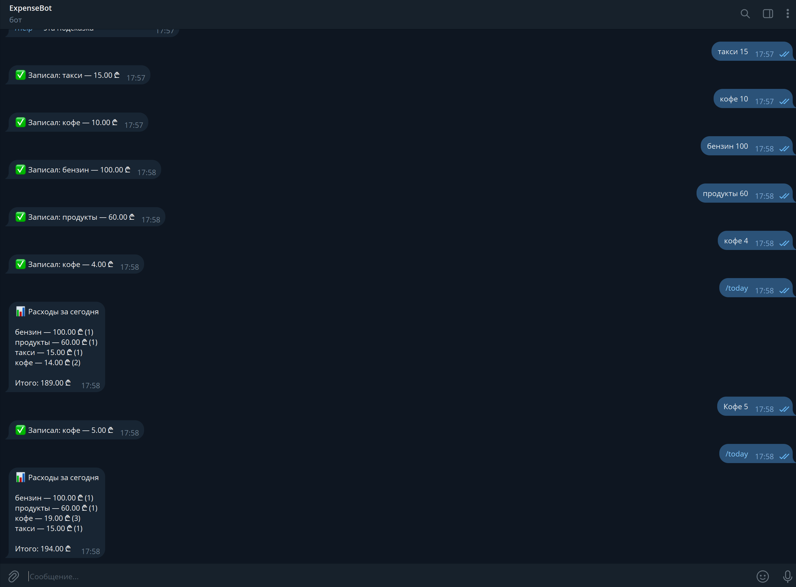

# ExpenseBot — Telegram expense tracker

*Read in [Russian / На русском](README.ru.md).*

A Telegram bot that records your expenses from plain messages and shows statistics by category. Built with C# (.NET 8), data is stored in SQLite.



## What it looks like

```
You:  coffee 5
Bot:  ✅ Saved: coffee — 5.00 USD

You:  25,50 groceries
Bot:  ✅ Saved: groceries — 25.50 USD

You:  /stats
Bot:  📊 Expenses for November 2026

      groceries — 25.50 USD (1)
      coffee — 5.00 USD (1)

      Total: 30.50 USD
```

## Commands

| Command  | What it does                                  |
|----------|-----------------------------------------------|
| `/today` | today's expenses by category                  |
| `/stats` | this month's expenses by category             |
| `/last`  | last 10 entries                               |
| `/undo`  | remove the last entry                         |
| `/help`  | show help                                     |

To add an expense, send `category amount` or `amount category`. The amount may use a dot or a comma (`5.5`, `5,5`) with up to two decimal places.

## Quick start

You need the [.NET 8 SDK](https://dotnet.microsoft.com/download/dotnet/8.0) (a newer SDK also works) and a bot token from [@BotFather](https://t.me/BotFather) (send `/newbot`).

Linux / macOS:

```bash
export TELEGRAM_BOT_TOKEN="123456:ABC..."
dotnet run --project src/ExpenseBot
```

Windows (PowerShell):

```powershell
$env:TELEGRAM_BOT_TOKEN="123456:ABC..."
dotnet run --project src/ExpenseBot
```

The bot works while the program is running; stop it with Ctrl+C. Keep the token secret and never commit it: it is read from an environment variable on purpose.

### Configuration (environment variables)

| Variable             | Default        | Purpose                                                       |
|----------------------|----------------|---------------------------------------------------------------|
| `TELEGRAM_BOT_TOKEN` | — (required)   | bot token from BotFather                                      |
| `BOT_LANGUAGE`       | `en`           | language of the bot's replies: `en` or `ru`                   |
| `CURRENCY`           | `USD`          | currency label shown in replies (for example `EUR` or `GEL`)  |
| `UTC_OFFSET_HOURS`   | `0`            | your time zone, used for "today" and "this month" (e.g. `4`)  |
| `DB_PATH`            | `expenses.db`  | path to the SQLite database file                              |

## Tests

```bash
dotnet test
```

The tests cover message parsing, every command, both languages, and the day and month boundaries with a time zone offset. They need neither Telegram nor a real database.

## Project structure

```
src/
  ExpenseBot.Core/        logic with no external dependencies
    ExpenseParser.cs        parses "coffee 5" into category and amount
    CommandProcessor.cs     message text -> reply text
    Formatter.cs            builds the replies
    Messages.cs             English and Russian texts, language selection
    Models.cs               Expense, CategoryTotal, IExpenseStore interface
  ExpenseBot/             the runnable bot
    Program.cs              Telegram connection and configuration
    SqliteExpenseStore.cs   SQLite storage
tests/
  ExpenseBot.Tests/       xunit tests
```

## Design decisions

- **Logic is separated from Telegram and the database.** `CommandProcessor` takes text and returns text, and storage is injected through the `IExpenseStore` interface. Tests use an in-memory store and run instantly.
- **Texts live behind an interface** (`IMessages`), so adding a language means adding one class.
- **Money is stored in cents** (integers) to avoid floating-point rounding errors.
- **Timestamps are stored in UTC**, while "today" and "this month" are computed in the local time zone from `UTC_OFFSET_HOURS`.
- **Each user sees only their own expenses** (entries are tied to the Telegram user ID).

## Ideas for further development

- Monthly budget with a warning when the limit is close.
- CSV export (`/export`).
- Statistics for an arbitrary period and a chart image.
- Docker image and deployment to a VPS.
