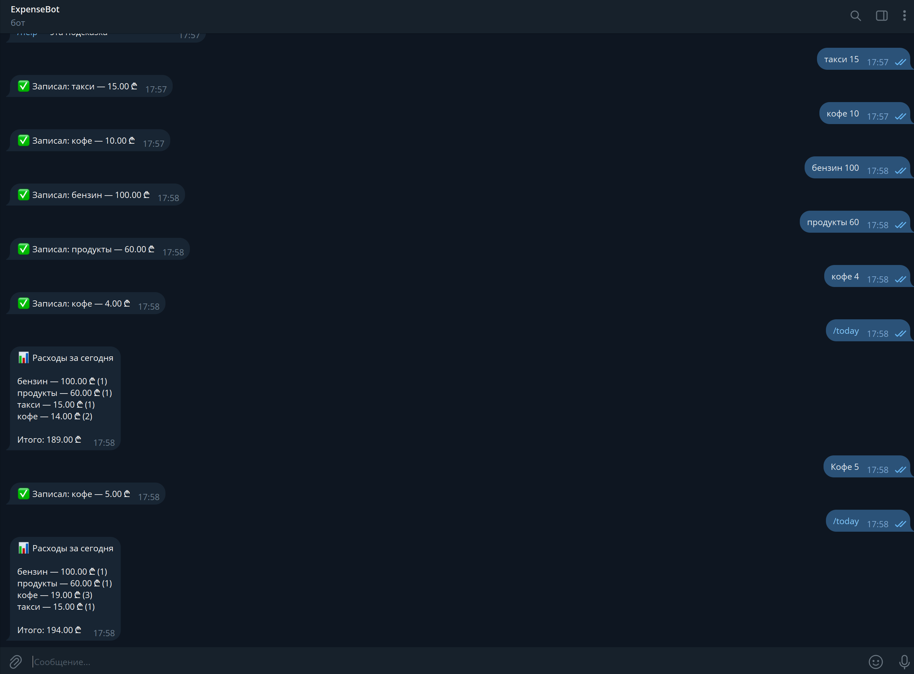

# ExpenseBot — Telegram-бот для учёта расходов

*Read in [English](README.md).*

Бот записывает траты из обычных сообщений и показывает статистику по категориям. Написан на C# (.NET 8), данные хранятся в SQLite.



## Как это выглядит

```
Ты:   кофе 5
Бот:  ✅ Записал: кофе — 5.00 USD

Ты:   25,50 продукты
Бот:  ✅ Записал: продукты — 25.50 USD

Ты:   /stats
Бот:  📊 Расходы за ноябрь 2026

      продукты — 25.50 USD (1)
      кофе — 5.00 USD (1)

      Итого: 30.50 USD
```

Язык ответов бота включается переменной `BOT_LANGUAGE=ru` (по умолчанию бот отвечает по-английски).

## Команды

| Команда  | Что делает                                   |
|----------|----------------------------------------------|
| `/today` | траты за сегодня по категориям               |
| `/stats` | траты за текущий месяц по категориям         |
| `/last`  | последние 10 записей                         |
| `/undo`  | удалить последнюю запись                     |
| `/help`  | подсказка                                    |

Формат траты: `категория сумма` или `сумма категория`. Сумма может быть с точкой или запятой (`5.5`, `5,5`), не больше двух знаков после запятой.

## Запуск

Нужен [.NET 8 SDK](https://dotnet.microsoft.com/download/dotnet/8.0) (более новый SDK тоже подходит) и токен бота от [@BotFather](https://t.me/BotFather) (команда `/newbot`).

Linux / macOS:

```bash
export TELEGRAM_BOT_TOKEN="123456:ABC..."
export BOT_LANGUAGE="ru"
dotnet run --project src/ExpenseBot
```

Windows (PowerShell):

```powershell
$env:TELEGRAM_BOT_TOKEN="123456:ABC..."
$env:BOT_LANGUAGE="ru"
dotnet run --project src/ExpenseBot
```

Бот работает, пока запущена программа, остановить можно через Ctrl+C. Токен храни в секрете и не добавляй в репозиторий: он специально читается из переменной окружения.

### Настройки (переменные окружения)

| Переменная           | По умолчанию   | Назначение                                                   |
|----------------------|----------------|--------------------------------------------------------------|
| `TELEGRAM_BOT_TOKEN` | — (обязательно) | токен от BotFather                                           |
| `BOT_LANGUAGE`       | `en`           | язык ответов бота: `en` или `ru`                             |
| `CURRENCY`           | `USD`          | обозначение валюты в ответах (например `EUR` или `GEL`)      |
| `UTC_OFFSET_HOURS`   | `0`            | часовой пояс для «сегодня» и «месяц» (например `4`)          |
| `DB_PATH`            | `expenses.db`  | путь к файлу базы SQLite                                     |

## Тесты

```bash
dotnet test
```

Тесты проверяют разбор сообщений, все команды, оба языка и границы дня и месяца с учётом часового пояса. Telegram и настоящая база для них не нужны.

## Структура

```
src/
  ExpenseBot.Core/        логика без внешних зависимостей
    ExpenseParser.cs        разбор «кофе 5» в категорию и сумму
    CommandProcessor.cs     текст сообщения -> текст ответа
    Formatter.cs            оформление ответов
    Messages.cs             тексты на английском и русском, выбор языка
    Models.cs               Expense, CategoryTotal, интерфейс IExpenseStore
  ExpenseBot/             запуск бота
    Program.cs              подключение к Telegram, настройки
    SqliteExpenseStore.cs   хранение в SQLite
tests/
  ExpenseBot.Tests/       xunit-тесты
```

## Принятые решения

- **Логика отделена от Telegram и базы.** `CommandProcessor` получает текст и возвращает текст, а хранилище подставляется через интерфейс `IExpenseStore`. Тесты работают с хранилищем в памяти и выполняются мгновенно.
- **Тексты спрятаны за интерфейсом** (`IMessages`): чтобы добавить язык, достаточно написать один класс.
- **Деньги хранятся в копейках** (целое число), чтобы не копить ошибки округления.
- **Время в базе в UTC**, а «сегодня» и «месяц» считаются по местному времени из `UTC_OFFSET_HOURS`.
- **Каждый пользователь видит только свои траты** (записи привязаны к Telegram ID).

## Идеи для развития

- Бюджет на месяц и предупреждение при приближении к лимиту.
- Экспорт в CSV (команда `/export`).
- Статистика за произвольный период и график в виде картинки.
- Docker-образ и запуск на VPS.
